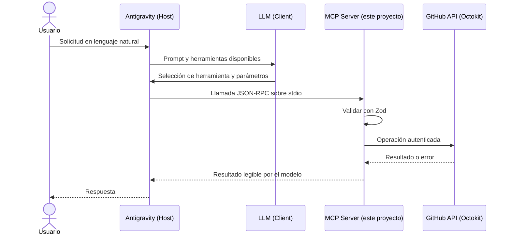

# GitHub AI Agent

Servidor MCP local para que un host compatible (por ejemplo Antigravity) permita a un LLM consultar y automatizar tareas habituales de GitHub mediante lenguaje natural. El servidor usa stdio para el protocolo MCP, Zod para validar entradas, Octokit para la API de GitHub y mensajes de error comprensibles.

## Arquitectura



El Host administra la sesión y conecta al Client con el Server. El LLM elige la herramienta a partir de las descripciones, por eso estas precisan intención y efecto. El servidor nunca escribe logs en stdout: stdout queda reservado al protocolo y el logging estructurado usa stderr.

## Requisitos

- Node.js 18 o superior y npm. Inspector 0.16 se conserva por compatibilidad con Node 18.
- Una cuenta de GitHub y un Personal Access Token con los permisos mínimos requeridos.
- Antigravity u otro host compatible con servidores MCP stdio.

## Instalación

```powershell
cd "C:\ruta\a\Proyecto M5"
npm install
Copy-Item .env.example .env
```

Edita `.env` localmente y asigna un token real a `GITHUB_TOKEN`. No pegues el token en el código, en una conversación, en `mcp.json` ni en Git. `.env` está excluido por `.gitignore`; `.env.example` no contiene credenciales.

Compilar y comprobar:

```powershell
npm run build
npm test
```

El resultado compilado queda en `dist/`. Para iniciar el servidor en desarrollo usa `npm run dev`; en una configuración de host se ejecuta `node dist/server.js`.

## Token y permisos

Se recomienda un **fine-grained personal access token** limitado a los repositorios necesarios. Concede acceso a los repositorios de prueba, Metadata: read, Contents: read/write, Issues: read/write y el permiso de administración/creación necesario para `POST /user/repos`. Las políticas de una organización pueden impedir la operación aunque el token sea válido.

Si usas un token clásico, `repo` permite crear repositorios privados y operar sobre repositorios; para crear repositorios públicos basta `public_repo`. La consigna menciona además `user` y `admin:org`, pero estas herramientas no leen/modifican el perfil del usuario ni administran organizaciones, por lo que no los requieren. No concedas `admin:org` salvo que amplíes el alcance y necesites administrar una organización. Confirma permisos y políticas de la cuenta antes de la demo.

## Configuración de Antigravity

Este proyecto incluye `.vscode/mcp.json` como ejemplo para hosts de VS Code compatibles. Para Antigravity, agrega un servidor MCP de tipo `stdio` en su configuración de MCP. Ejemplo Windows (reemplaza la ruta por la ubicación real):

```json
{
  "mcpServers": {
    "automatehub-github": {
      "command": "node",
      "args": ["C:/ruta/a/Proyecto M5/dist/server.js"],
      "env": {
        "GITHUB_TOKEN": "${GITHUB_TOKEN}"
      }
    }
  }
}
```

La sintaxis exacta de sustitución de variables depende de la versión del host. Si Antigravity no expande `${GITHUB_TOKEN}`, configura la variable en el entorno del proceso que lanza el host; no escribas el secreto en el archivo JSON. Compila antes de conectar el server. Confirma en el host que aparecen las ocho herramientas.

## Herramientas

| Tool | Parámetros principales | Ejemplo de prompt |
| --- | --- | --- |
| `create_repository` | `name`, `description?`, `private?` | “Crea un repositorio privado llamado `api-demo` con una descripción breve.” |
| `create_issue` | `owner`, `repo`, `title`, `body?` | “Abre un issue en `octo/api-demo` para documentar el endpoint de salud.” |
| `list_repositories` | `type?` (`owner` por defecto) | “Lista mis repositorios privados.” |
| `create_commit` | `owner`, `repo`, `path`, `message`, `content`, `branch?` | “Agrega `docs/plan.md` a `octo/api-demo` en la rama `main` con este contenido: …” |
| `list_issues` | `owner`, `repo`, `perPage?` (1-100) | “Lista los issues abiertos de `octo/api-demo`.” |
| `create_branch` | `owner`, `repo`, `branch`, `fromBranch?` | “Crea `feature/health-check` desde `main` en `octo/api-demo`.” |
| `close_issue` | `owner`, `repo`, `issueNumber` | “Cierra el issue 12 de `octo/api-demo`.” |
| `add_comment_to_issue` | `owner`, `repo`, `issueNumber`, `body` | “Comenta en el issue 12 de `octo/api-demo`: ya está corregido en main.” |

Los nombres de repositorio admiten de 3 a 100 caracteres, letras, números y guiones, y no permiten guion al principio o al final. El valor predeterminado de repositorio es privado. `create_commit` crea o reemplaza completamente un archivo de texto; si el archivo ya existe, obtiene su SHA antes de actualizarlo.

## MCP Inspector

Para listar y probar herramientas localmente:

```powershell
npm run inspector
```

El script compila y lanza MCP Inspector 0.16 apuntando al servidor stdio. Si el puerto local ya está ocupado, detén el proceso correspondiente o usa el puerto alternativo que indique Inspector. No ejecutes comandos de diagnóstico que escriban en stdout dentro del proceso servidor.

## Pruebas

```powershell
npm test
npm run build
```

Las pruebas mockean Octokit y no llaman a GitHub. Cubren validación de schemas, creación y modificación de archivos, filtrado de pull requests, errores 404 y rate limiting.

Aviso de dependencias: la versión de Vitest compatible con Node 18 tiene avisos transitivos publicados. Las versiones corregidas actualmente requieren Node 20; no se fuerza esa actualización para conservar Node 18 como mínimo de ejecución.

## Estructura

```text
src/
  errors/       clasificación y mensajes para el usuario
  github/       cliente Octokit y operaciones
  schemas/      esquemas Zod de las ocho herramientas
  tools/        descripciones y registro de herramientas MCP
  utils/        logging a stderr y retry de rate limit
  server.ts     entry point stdio
tests/          pruebas unitarias Vitest
```

## Solución de problemas

- **No inicia: falta `GITHUB_TOKEN`:** crea `.env` a partir de `.env.example` o configura la variable de entorno del proceso del host.
- **401 Bad credentials:** token inválido, revocado o expirado; crea uno nuevo y actualiza el entorno.
- **403 Forbidden:** comprueba permisos del token, acceso al repositorio y políticas de la organización. El 403 de rate limit espera y reintenta una vez con los headers de GitHub.
- **404 Not Found:** verifica propietario, repositorio, rama y número del issue. GitHub puede devolver 404 para recursos privados sin acceso.
- **Antigravity no muestra tools:** confirma que `dist/server.js` existe (`npm run build`), que Node está en PATH y que el host lee la ruta/configuración MCP indicada.
- **stdout contiene texto inesperado:** no añadas `console.log` al servidor; los logs deben ir por `src/utils/logging.ts` a stderr.
- **Inspector no instala o no arranca:** verifica conectividad npm y Node 18+; ejecuta el script desde la raíz del proyecto y revisa el puerto disponible.

## Defensa del proyecto

Ideas para explicar las decisiones técnicas y practicar una demo están en [docs/DEFENSA.md](docs/DEFENSA.md).

## Licencia

MIT. Consulta [LICENSE](LICENSE).