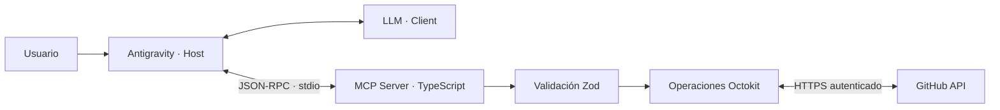

# GitHub AI Agent
### Proyecto Integrador 5 · Backend
AutomateHub · MCP Server para operaciones de GitHub

---

## El problema

- Tareas repetitivas en GitHub interrumpen el trabajo de desarrollo.
- Un agente puede traducir una petición en lenguaje natural a una operación concreta.
- El servidor valida la intención y ejecuta la llamada autenticada, sin entregar el token al LLM.

**Objetivo:** automatizar operaciones comunes con un contrato MCP seguro y comprobable.

---

## Chatbot, asistente y agente

- **Chatbot:** conversa y responde.
- **Asistente AI:** ayuda dentro de un flujo de trabajo.
- **AI Agent:** decide entre herramientas disponibles, propone parámetros y actúa mediante ellas.

El LLM elige la herramienta. Las descripciones precisas reducen llamadas incorrectas.

---

## Arquitectura MCP

Host gestiona la sesión; Client elige tools; Server valida y opera; GitHub responde.

---

## Ocho herramientas

**Base:** crear repositorio, crear issue, listar repositorios, crear/actualizar archivo con commit y listar issues abiertos.

**Extras:** crear rama, cerrar issue y añadir comentario.

Las escrituras requieren autorización del usuario; los repositorios nuevos son privados por defecto.

---

## Organización y decisiones

- `schemas/`: Zod valida antes de llegar a GitHub y describe campos al LLM.
- `github/client.ts`: crea Octokit con el token del entorno.
- `github/operations.ts`: concentra API calls y permite inyectar un mock.
- `tools/`: registra herramientas con descripciones orientadas a intención.
- `errors/` y `utils/`: mensajes naturales, retry limitado y logging a stderr.

stdout es el canal MCP: un `console.log` podría romper JSON-RPC.

---

## Seguridad y resiliencia

- PAT solo en `GITHUB_TOKEN`; `.env` ignorado por Git.
- Permisos mínimos: repo privado requiere `repo` (classic); organizaciones pueden imponer políticas adicionales.
- Errores 401/403/404/red se traducen a instrucciones claras.
- 429 o 403 por rate limit se reintenta una vez respetando `Retry-After`.
- No se registran credenciales ni stack traces para el usuario.

---

## Estrategia de pruebas

- 19 tests unitarios con Vitest.
- Octokit está simulado: sin llamadas reales, cambios de estado ni consumo de rate limit.
- Casos: schemas válidos/incorrectos, actualización de archivos con SHA, pull request excluido de issues, 404, auth, red y retry.
- Comandos: `npm test` y `npm run build`.

---

## Demo en vivo

1. Mostrar herramientas registradas en Antigravity o Inspector.
2. Pedir: “Lista mis repositorios propios”.
3. Pedir: “Lista issues abiertos en `OWNER/REPO`”.
4. Crear issue de prueba y comentar en ese issue.
5. Mostrar un error de validación claro y las pruebas pasando.

Usar un repositorio de demo, verificar permisos y mantener `.env` fuera de pantalla.

---

## Límites y próximos pasos

- Listados limitados a una página de 100 repositorios o el máximo indicado.
- `create_commit` reemplaza el archivo completo, no aplica diff.
- El retry es acotado; tras agotar el límite, la persona espera y vuelve a intentar.
- Mejoras: paginación, confirmación antes de escritura, preflight de permisos y create pull request.

**Conclusión:** MCP separa al modelo de las credenciales y ofrece una interfaz estándar para automatizar GitHub con validación y trazabilidad.